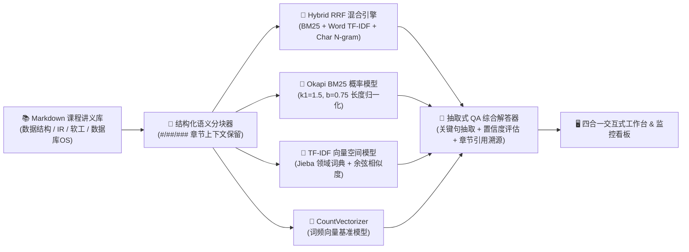

# 🎓 CourseQA — 智能课程问答与多引擎信息检索系统 (v3.0)

基于 **FastAPI + 四路检索引擎（Hybrid RRF / Okapi BM25 / TF-IDF / CountVectorizer）+ 抽取式知识问答合成** 构建的高校计算机课程知识库检索与问答工作台。支持 Markdown 讲义结构化语义分块、专业术语词典增强、多引擎同台竞技对比、知识库在线编辑与无感热重载、批量并发评测及检索指标可视化看板。

---

## ✨ 核心架构与工程亮点



### 1. 四路异构检索引擎与 RRF 倒数排名融合 (`core/qa_engine.py`)
| 检索引擎标识 | 核心算法与数学模型 | 优势与适用场景 |
| :--- | :--- | :--- |
| **`hybrid` (默认推荐)** | **Reciprocal Rank Fusion (RRF)**：融合 BM25、词级 TF-IDF 与字符级 2~4 Gram TF-IDF，$\text{RRF}(d) = \sum \frac{1}{60 + \text{rank}_i(d)}$ | 兼顾精确专业术语匹配、长短文档均衡与分词容错，综合 Top-1 准确率最高 |
| **`bm25`** | **Okapi BM25 概率检索模型**：引入词频饱和度 $k_1=1.5$ 与文档长度归一化 $b=0.75$ | 有效抑制长文档词频累加偏置与高频词重复失真 |
| **`tfidf`** | **TF-IDF + Cosine Similarity**：结合计算机领域自定义词典与同义词查询扩展 | 经典向量空间检索基准，计算极快 |
| **`count`** | **CountVectorizer + Cosine Similarity**：原始词频向量余弦匹配 | 用于教学实验与多引擎召回对比 |

### 2. 结构化 Markdown 语义切分与领域词典增强
- **多级标题感知分块**：自动解析 `#`（文档主标题）与 `## / ###`（章节子标题），在段落边界自适应切分，将章节上下文元信息注入向量特征。
- **领域术语保护与同义词扩展**：内置 `Dijkstra`、`Bellman-Ford`、`Min-Heap`、`Top-K`、`BM25`、`TF-IDF`、`MVCC`、`ACID`、`B+树`、`红黑树` 等专有词条与同义词映射表，防止分词碎片化。
- **抽取式问答合成 (`synthesize_answer`)**：基于 Top-K 命中知识块自动抽取核心结论句，生成带 `[1][2]` 章节来源引用的结构化解答、置信度评分及关联追问建议。

### 3. 四合一 Web 交互工作台 (`static/index.html` & `static/dashboard.html`)
1. **🔍 智能问答与检索**：支持关键词高亮（`<mark>`）、置信度徽标、引用溯源、一键复制解答与精选课程问题快速体验。
2. **⚔️ 多引擎对比竞技场**：同一查询下四路引擎同屏横向PK（对比耗时、Top-1 得分、与 Hybrid 重合率及召回排序）。
3. **📚 知识库在线管理与分块预览**：在线浏览 4 大核心课程讲义的语义分块，支持在线新建/编辑 Markdown 讲义并一键触发 `/api/reload` 零停机热重载。
4. **🧪 批量并发评测与 📊 数据看板**：支持多问题并发测试、引擎调用分布图、高频查询榜单、查询重放与 UTF-8-BOM CSV 报表导出。

---

## 📂 项目目录结构

```text
CourseQA/
├── app.py                      # FastAPI 主入口（检索、对比、批量评测、知识库 CRUD、热重载）
├── config/
│   └── settings.py             # 路径配置、BM25 超参数 (k1=1.5, b=0.75) 与日志配置
├── core/
│   └── qa_engine.py            # 四引擎检索核心、RRF 混合融合、抽取式问答合成与 Markdown 语义切分
├── api/
│   ├── history_api.py          # 检索历史持久化、条件筛选、删除与 UTF-8-BOM CSV 导出
│   └── stats_api.py            # 在线指标统计（平均延迟、零命中率、引擎分布、词表规模）
├── data/md/                    # 多学科结构化课程知识库
│   ├── course_notes.md                              # 数据结构与算法核心笔记
│   ├── 02_information_retrieval_and_nlp.md          # 信息检索与自然语言处理讲义
│   ├── 03_software_engineering_and_architecture.md  # 软件工程与系统架构核心讲义
│   └── 04_database_and_operating_systems.md         # 数据库系统与操作系统核心讲义
├── static/
│   ├── index.html              # 四合一智能问答、多引擎竞技场、知识库管理与批量评测前端
│   └── dashboard.html          # 检索统计指标可视化与历史审计看板
├── tests/
│   └── test_courseqa.py        # 自动化单元测试集
├── utils/
│   └── time_utils.py           # 高精度毫秒级计时器上下文管理器
└── requirements.txt
```

---

## 🚀 快速启动与验证

### 1. 安装依赖并启动服务
```bash
pip install -r requirements.txt
python app.py
```

### 2. 访问系统页面
- **智能问答与竞技场工作台**：`http://127.0.0.1:8000/`
- **检索统计与历史审计看板**：`http://127.0.0.1:8000/dashboard`
- **Swagger 交互式 API 文档**：`http://127.0.0.1:8000/docs`

### 3. 运行单元测试
```bash
python -m unittest discover -s tests -v
```
